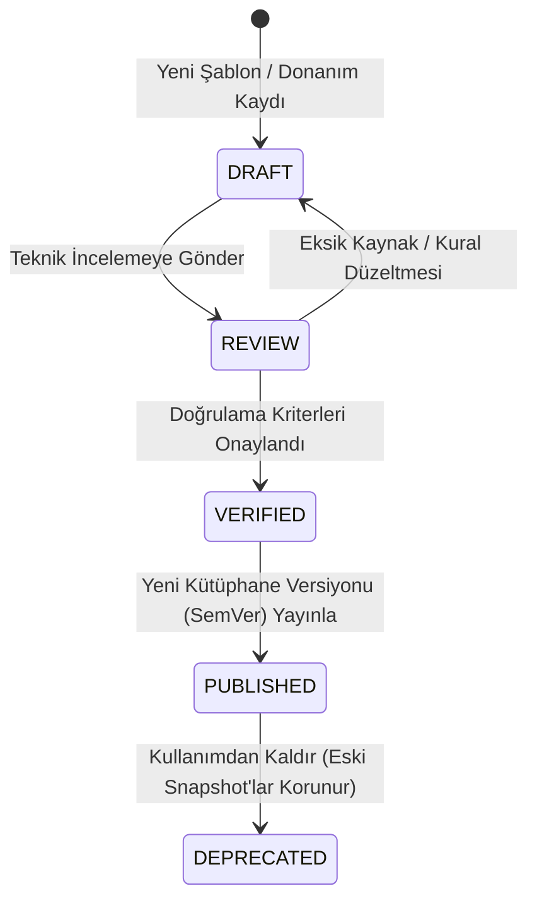

# BİRİM CONFIGURATOR V4 — KÜTÜPHANE YÖNETİM PANELİ VE YAYIN SÜRECİ (`LIBRARY_ADMIN.md`)

**Tarih:** 4 Kasım 2026  
**Sürüm:** V4.0  
**Durum:** `IMPLEMENTED` / `TESTED` (Faz 12 Tamamlandı)

---

## 1. AMAÇ: GELİŞTİRİCİYE İHTİYAÇ DUYMADAN KÜTÜPHANE GENİŞLETME

Kütüphane Yönetim Servisi (`packages/catalog/src/v4-library-admin.ts`) ve `/v3` arayüzündeki **V4 Kütüphane Yönetim Paneli**, ürün mühendislerinin kod yazmadan:
- Yeni modül ailesi ve parametrik modül şablonu tanımlamasını,
- Ölçü presetleri ve yapı kuralları oluşturmasını,
- Yeni donanım ürünü (SKU, üretici, yük limiti, delik şablonu, kesim düşüm formülü) eklemesini,
- Teknik kaynak dokümanı (`technical_sources`) ve 5 boyutlu doğrulama kaydı (`verification_records`) ilişkilendirmesini,
- Yaşam döngüsü durumlarını yönetmesini sağlar.

---

## 2. BEŞ AŞAMALI YAYIN YAŞAM DÖNGÜSÜ (LIFECYCLE STATE MACHINE)

### 2.1 Beş Boyutlu `VERIFIED` Doğrulama Kapsamı (`VerificationScopeFlags`)
Bir kaydın katalogdan doğrulanması fiziksel üretim doğrulaması anlamına gelmez! Bu nedenle her donanım ve modül kaydında **5 ayrı boolean doğrulama alanı** tutulur:
1. **`sourceTechDataVerified`**: Üretici resmî kataloğu veya EN/ISO standardı (`sourceId`) ile teknik veriler doğrulandı mı?
2. **`cadGeometryVerified`**: 2D/3D boyutları ve hareket/çarpışma kinematiği doğrulandı mı?
3. **`bomFormulaVerified`**: Kesim düşümleri ($LW$ formülleri), parça adetleri ve birim maliyet doğrulandı mı?
4. **`drillingPatternVerified`**: System 32 delik koordinatları, çapları ve derinlikleri doğrulandı mı?
5. **`physicalFactorySampleTested`**: Birim fabrikasında gerçek panel, bağlantı, CNC makinesi ve donanım numunesi ile fiziksel üretim testi yapıldı mı?

### 2.2 Geçiş Kuralları (Gate Rules)
- Bir kayıt `DRAFT` $\to$ `REVIEW` $\to$ `VERIFIED` durumuna geçebilmesi için en az `sourceTechDataVerified`, `cadGeometryVerified`, `bomFormulaVerified` ve `drillingPatternVerified` alanlarının `true` olması ve geçerli bir `sourceId` taşıması zorunludur.
- `physicalFactorySampleTested === false` olan kayıtlar mağaza tasarımında ve BOM/teklif aşamasında kullanılabilir, ancak CNC üretim ihracında `BLOCKED_BY_FACTORY_VALIDATION` uyarısı üretir.
- `PUBLISHED` durumundaki bir kütüphane sürümü (`PublishedLibraryRelease`) SHA-256 özetiyle dondurulur; sonraki düzenlemeler mevcut kilitli tasarım snapshot'larını (`design_versions`) **asla geriye dönük değiştirmez**.
