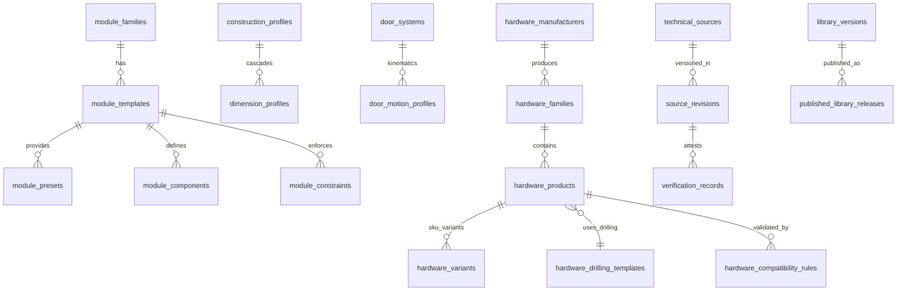

# BİRİM CONFIGURATOR V4 — VERİTABANI VE KÜTÜPHANE MİMARİSİ (`LIBRARY_DATABASE_DESIGN.md`)

**Tarih:** 4 Kasım 2026  
**Sürüm:** V4.0  
**Durum:** `IMPLEMENTED` / `TESTED` (Veri Mimarisi & İzolasyon Kuralları)

---

## 1. İZOLASYON VE GÜVENLİK PRENSİBİ

- **Sıfır Canlı Müdahale:** Mevcut ortak Supabase production veya staging (`birim-portal` / `birim-store`) veritabanlarına hiçbir bağlantı kurulmaz ve DDL/migration çalıştırılmaz.
- **Kanonik İlişkisel Model:** Tüm 24 mantıksal varlık, ileride izole `configurator_v4` PostgreSQL şemasında devreye alınacak şekilde tasarlanmış ve aynı zamanda `@birim/core` ile `@birim/catalog` içinde **%100 tip güvenli TypeScript bellek-içi (in-memory) ilişkisel kayıt defteri** olarak somutlaştırılmıştır.
- **Snapshot Değişmezliği (Immutability):** Kütüphanede yapılan bir kural veya donanım güncellemesi yeni bir `library_version` üretir; daha önce `quoted` veya `production_approved` durumuna geçmiş tasarım snapshot'larını (`design_versions`) geriye dönük olarak kesinlikle değiştirmez.

---

## 2. VARLIK İLİŞKİ DİYAGRAMI (ER DIAGRAM — 24 MANTIKSAL VARLIK)



---

## 3. İZOLASYONLU POSTGRESQL DDL ŞEMASI (`configurator_v4`)

```sql
create schema if not exists configurator_v4;

-- 1. Kaynak ve Doğrulama Katmanı (Source & Verification Registry)
create table configurator_v4.technical_sources (
    id text primary key, -- ör: 'SRC_BLUM_CAT_HINGE'
    issuer text not null,
    title text not null,
    document_type text not null, -- 'STANDARD', 'CATALOG', 'INSTALLATION_MANUAL', 'FACTORY_SPEC'
    official_url text,
    created_at timestamptz default now()
);

create table configurator_v4.source_revisions (
    id text primary key, -- ör: 'REV_SRC_BLUM_2024_1'
    source_id text not null references configurator_v4.technical_sources(id),
    revision_code text not null,
    published_year integer,
    accessed_at date not null,
    license_notes text
);

create table configurator_v4.verification_records (
    id text primary key,
    target_entity_type text not null, -- 'hardware_product', 'module_template', 'manufacturing_rule'
    target_entity_id text not null,
    source_revision_id text references configurator_v4.source_revisions(id),
    catalog_data_verified boolean not null default false,
    cad_geometry_verified boolean not null default false,
    bom_formula_verified boolean not null default false,
    drilling_pattern_verified boolean not null default false,
    physical_factory_sample_tested boolean not null default false,
    verified_by text,
    verified_at timestamptz default now()
);

-- 2. Kütüphane Versiyonlama ve Yayın Süreci (DRAFT -> REVIEW -> VERIFIED -> PUBLISHED -> DEPRECATED)
create table configurator_v4.library_versions (
    id text primary key, -- ör: 'lib_v4_0_0'
    semver text not null unique,
    lifecycle_state text not null check (lifecycle_state in ('DRAFT', 'REVIEW', 'VERIFIED', 'PUBLISHED', 'DEPRECATED')),
    changelog text,
    created_by text not null,
    created_at timestamptz default now()
);

create table configurator_v4.published_library_releases (
    id uuid default gen_random_uuid() primary key,
    library_version_id text not null references configurator_v4.library_versions(id),
    snapshot_hash_sha256 text not null,
    frozen_catalog_json jsonb not null,
    published_by text not null,
    published_at timestamptz default now()
);

-- 3. Yapı, Ölçü, Malzeme ve Üretim Kuralları (Profiles & Rules)
create table configurator_v4.construction_profiles (
    id text primary key, -- 'profile_intl_en1116', 'profile_birim_factory_std'
    layer_type text not null check (layer_type in ('INTERNATIONAL', 'MANUFACTURER', 'FACTORY', 'PROJECT_OVERRIDE')),
    name text not null,
    panel_thickness_mm numeric not null default 18,
    back_panel_thickness_mm numeric not null default 8,
    back_panel_type text not null default 'grooved',
    edge_band_thickness_mm numeric not null default 1.0,
    joint_type text not null default 'minifix_dowel',
    system32_pitch_mm numeric not null default 32,
    system32_front_setback_mm numeric not null default 37,
    source_id text references configurator_v4.technical_sources(id)
);

create table configurator_v4.dimension_profiles (
    id text primary key,
    construction_profile_id text not null references configurator_v4.construction_profiles(id),
    min_width_mm numeric not null,
    max_width_mm numeric not null,
    min_height_mm numeric not null,
    max_height_mm numeric not null,
    min_depth_mm numeric not null,
    max_depth_mm numeric not null,
    default_plinth_mm numeric not null default 80,
    door_perimeter_gap_mm numeric not null default 2.0,
    max_unsupported_shelf_span_mm numeric not null default 950
);

create table configurator_v4.material_profiles (
    id text primary key,
    name text not null,
    category text not null check (category in ('laminate', 'wood', 'lacquer', 'glass', 'metal', 'stone', 'mirror', 'compact')),
    default_thickness_mm numeric not null default 18,
    density_kg_m3 numeric not null default 720,
    cost_per_m2_eur numeric not null,
    edge_band_cost_per_m_eur numeric not null default 1.5,
    has_grain boolean not null default false,
    pbr_config jsonb not null
);

create table configurator_v4.manufacturing_rules (
    id text primary key,
    code text not null unique,
    name text not null,
    machine_target text, -- ör: 'Biesse_Selco_WNT_600', 'System32_CNC'
    rule_parameters jsonb not null,
    verification_status text not null check (verification_status in ('VERIFIED', 'UNVERIFIED', 'BLOCKED_BY_FACTORY_VALIDATION')),
    source_id text references configurator_v4.technical_sources(id)
);

-- 4. Kapak, Hareket, Açılma ve Kulp Varlıkları (Doors, Motion, Handles)
create table configurator_v4.door_systems (
    id text primary key, -- 12 kategori: 'hinged_single', 'lift_bi_fold', 'pocket_retractable', vb.
    name text not null,
    leaf_count integer not null default 1,
    overlay_type text not null check (overlay_type in ('full_overlay', 'half_overlay', 'inset')),
    min_carcass_depth_mm numeric not null default 300,
    pocket_width_deduction_mm numeric not null default 0,
    verification_status text not null default 'VERIFIED'
);

create table configurator_v4.door_motion_profiles (
    id text primary key,
    door_system_id text not null references configurator_v4.door_systems(id),
    kinematic_type text not null, -- 'pivot_vertical', 'slide_horizontal', 'lift_parallel', 'lift_bifold', 'pivot_slide_pocket'
    max_open_angle_deg numeric not null default 110,
    max_slide_ratio numeric not null default 0,
    collision_sweep_formula jsonb not null
);

create table configurator_v4.opening_mechanisms (
    id text primary key, -- 'manual_standard', 'soft_close', 'push_to_open', 'push_to_open_soft_close', 'servo_electric'
    name text not null,
    requires_handle boolean not null default true,
    requires_electricity boolean not null default false,
    trigger_gap_mm numeric not null default 0
);

create table configurator_v4.handle_profiles (
    id text primary key,
    category text not null, -- 10 kategori: 'knob', 'bar_handle', 'gola_profile', 'j_pull', 'handleless_plain', vb.
    name text not null,
    hole_spacing_cc_mm numeric, -- ör: 160, 320 veya null
    protrusion_mm numeric not null default 0,
    door_height_deduction_mm numeric not null default 0,
    min_door_thickness_mm numeric not null default 16,
    weight_kg numeric not null default 0.15
);

-- 5. Donanım Üreticileri, Aileleri, Ürünleri, Delik Şablonları ve Uyumluluk Kuralları
create table configurator_v4.hardware_manufacturers (
    id text primary key, -- 'mfr_blum', 'mfr_hettich', vb.
    name text not null,
    country text not null,
    official_website text,
    is_preferred_supplier boolean not null default false
);

create table configurator_v4.hardware_families (
    id text primary key,
    manufacturer_id text not null references configurator_v4.hardware_manufacturers(id),
    category text not null, -- 'hinge', 'drawer_box', 'runner', 'lift', 'sliding', 'pocket', 'wardrobe_acc', 'kitchen_acc'
    name text not null
);

create table configurator_v4.hardware_drilling_templates (
    id text primary key, -- 'tpl_drill_blum_hinge_45x95', 'tpl_drill_hettich_th52'
    name text not null,
    cup_diameter_mm numeric,
    cup_depth_mm numeric,
    cup_edge_tab_mm numeric,
    boss_pitch_mm numeric,
    boss_offset_mm numeric,
    system32_front_setback_mm numeric not null default 37,
    hole_operations_json jsonb not null,
    source_id text references configurator_v4.technical_sources(id)
);

create table configurator_v4.hardware_products (
    id text primary key,
    manufacturer_id text not null references configurator_v4.hardware_manufacturers(id),
    family_id text not null references configurator_v4.hardware_families(id),
    drilling_template_id text references configurator_v4.hardware_drilling_templates(id),
    sku text not null,
    name text not null,
    lifecycle_status text not null default 'ACTIVE',
    load_capacity_kg numeric not null default 0,
    min_door_thickness_mm numeric default 16,
    max_door_thickness_mm numeric default 24,
    clearances_json jsonb not null default '{}',
    unit_price_eur numeric not null default 0,
    source_id text references configurator_v4.technical_sources(id),
    verification_id text references configurator_v4.verification_records(id)
);

create table configurator_v4.hardware_variants (
    id text primary key,
    product_id text not null references configurator_v4.hardware_products(id),
    variant_sku text not null,
    nominal_length_mm numeric, -- ör: 270, 350, 400, 450, 500, 550, 600
    color_finish text default 'inox',
    power_factor_min numeric,
    power_factor_max numeric,
    unit_price_eur numeric not null
);

create table configurator_v4.hardware_compatibility_rules (
    id text primary key,
    code text not null unique,
    category text not null, -- 1..15 kontrol kategorisi
    description text not null,
    condition_expression_json jsonb not null,
    result_status text not null check (result_status in ('COMPATIBLE', 'COMPATIBLE_WITH_CONDITIONS', 'INCOMPATIBLE', 'UNVERIFIED')),
    remediation_suggestions_json jsonb not null,
    source_id text references configurator_v4.technical_sources(id)
);

-- 6. Modül Aileleri, Şablonlar, Presetler, Bileşenler ve Kısıtlar
create table configurator_v4.module_families (
    id text primary key, -- 'fam_kitchen_base', 'fam_kitchen_wall', 'fam_kitchen_tall', 'fam_wardrobe', 'fam_special_corner', 'fam_complementary'
    code text not null unique,
    name text not null,
    default_construction_profile_id text references configurator_v4.construction_profiles(id),
    default_dimension_profile_id text references configurator_v4.dimension_profiles(id)
);

create table configurator_v4.module_templates (
    id text primary key, -- 92 şablon: 'tpl_kb_01_single_door' .. 'tpl_cm_15_service_spacer'
    family_id text not null references configurator_v4.module_families(id),
    code text not null unique,
    name text not null,
    description text not null,
    default_dimensions_mm jsonb not null, -- {width, height, depth}
    dimension_limits_mm jsonb not null, -- {minW, maxW, minH, maxH, minD, maxD}
    compatible_door_systems text[] not null,
    default_door_system_id text references configurator_v4.door_systems(id),
    lifecycle_state text not null default 'PUBLISHED'
);

create table configurator_v4.module_presets (
    id text primary key,
    template_id text not null references configurator_v4.module_templates(id),
    name text not null,
    dimensions_mm jsonb not null,
    preset_payload_json jsonb not null
);

create table configurator_v4.module_components (
    id text primary key,
    template_id text not null references configurator_v4.module_templates(id),
    component_role text not null, -- 'carcass_side_left', 'carcass_bottom', 'shelf', 'drawer', 'door', 'countertop'
    parametric_formula_json jsonb not null,
    is_required boolean not null default true
);

create table configurator_v4.module_constraints (
    id text primary key,
    template_id text not null references configurator_v4.module_templates(id),
    constraint_code text not null,
    rule_type text not null, -- 'VENTILATION', 'PLUMBING', 'CORNER_FILLER', 'ZERO_PROTRUSION_HINGE', 'APPLIANCE_RECESS'
    parameters_json jsonb not null,
    blocking_production boolean not null default true
);
```
