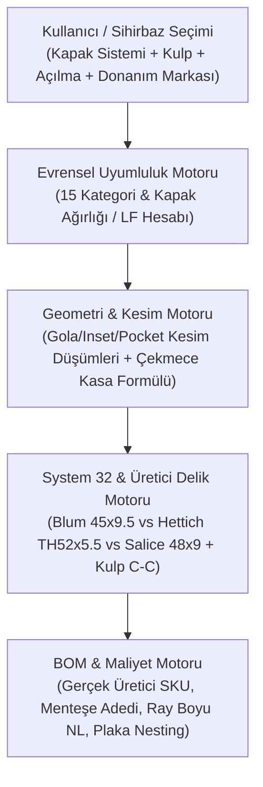

# BİRİM CONFIGURATOR V4 — BOM, CNC VE ÜRETİM MOTORU ENTEGRASYONU (`MANUFACTURING_INTEGRATION.md`)

**Tarih:** 4 Kasım 2026  
**Sürüm:** V4.0  
**Durum:** `IMPLEMENTED` / `TESTED` (Faz 11 Tamamlandı)

---

## 1. DİNAMİK DONANIM → DELİK → BOM → MALİYET ZİNCİRİ

V4 üretim motorunda (`@birim/manufacturing`), bir modülün kapak sistemi, kulp tipi veya donanım ürünü değiştiğinde aşağıdaki tüm teknik çıktılar deterministik olarak yeniden hesaplanır:

### 1.1 Somut Mühendislik Örneği: Standart 110° Menteşe $\to$ 155° Sıfır Çıkıntılı Menteşe veya Hettich Sensys Değişimi
1. **Blum 110° (`71B3550`) $\to$ Blum 155° Sıfır Çıkıntılı (`71B7550`) Değişimi:**
   - **Uyumluluk:** İç çekmeceli (`isInternal: true`) bölmelerde `WARN_INTERNAL_DRAWER_HINGE_COLLISION` uyarısı ortadan kalkar (`COMPATIBLE`).
   - **Delik Düzeni (`drilling-engine.ts`):** Menteşe tas derinliği $13.0\text{ mm}$'den **$11.7\text{ mm}$**'ye güncellenir.
   - **Hareket Geometrisi (`mesh-generator.ts`):** Maksimum açılma açısı $110^\circ$'den $155^\circ$'ye çıkar ve kapak açıldığında iç genişlikten sıfır çıkıntı yapar.
   - **BOM & Maliyet (`bom-generator.ts`):** Donanım listesinde SKU `71B3550` ($3.80\text{ EUR}$) yerine `71B7550` ($6.40\text{ EUR}$) olarak güncellenir.
2. **Blum (`71B3550`) $\to$ Hettich Sensys 110° (`9071205`) Değişimi:**
   - **Delik Düzeni:** Kapak arkasındaki yan vida/dübel delikleri $45 \times 9.5\text{ mm}$ ($\pm 22.5\text{ mm}$) yerine Hettich TH52 kalıbına (**$52 \times 5.5\text{ mm}$**, yani $\pm 26.0\text{ mm}$ dikey, $5.5\text{ mm}$ yatay ofset) ve tas derinliği **$12.8\text{ mm}$**'ye dönüşür!
3. **Çekmece Ray Sistemi Değişimi (Blum LEGRABOX vs. Hettich AvanTech YOU vs. Blum MOVENTO):**
   - **Blum LEGRABOX (`hw_blum_legrabox_m40`):** Çekmece taban genişliği $LW - 35\text{ mm}$, sırt genişliği $LW - 38\text{ mm}$, boy $NL - 10\text{ mm}$.
   - **Hettich AvanTech YOU (`hw_hettich_avantech_m`):** Çekmece taban genişliği $LW - 24\text{ mm}$, sırt genişliği $LW - 24\text{ mm}$, boy $NL - 21\text{ mm}$.
   - **Blum MOVENTO (`hw_blum_movento_760h`):** Ahşap çekmece iç kasa genişliği $LW - 42\text{ mm}$, boy $NL - 10\text{ mm}$.
   - Ayrıca ray nominal boyu ($NL \in \{270, 350, 400, 450, 500, 550, 600\}\text{ mm}$) dolabın gerçek net iç derinliğine ($D_{\text{inner}}$) göre **otomatik seçilir** (sabit $500\text{ mm}$ hatası giderilmiştir).

---

## 2. ÜRETİM ONAYI VE FABRİKA DOĞRULAMA KİLİDİ (FAIL-CLOSED)

- Tasarımda herhangi bir `INCOMPATIBLE` (`severity: "error"`) veya doğrulanmamış mekanizma (`UNVERIFIED`, ör. tambur kapak veya özel açılı çatı kesimi) varsa `approveProduction()` fonksiyonu **üretim onayını reddeder**.
- Selco WNT 600 XML/CIX paketi (`selco-adapter.ts`) üzerinde fiziksel makine doğrulaması bekleyen parametreler (`sawBladeKerfMm = 4.4`, `minGripperCutWidthMm = 70`) `DRAFT_UNVERIFIED_PENDING_FACTORY_CONFIRMATION` statüsüyle işaretlenir.
