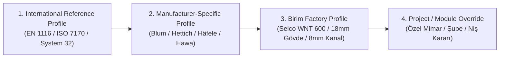

# BİRİM CONFIGURATOR V4 — ÖLÇÜ, GÖVDE VE ÜRETİM KURALLARI (`MODULE_DIMENSION_RULES.md`)

**Tarih:** 4 Kasım 2026  
**Sürüm:** V4.0  
**Durum:** `IMPLEMENTED` / `TESTED` (Faz 03 Tamamlandı)

---

## 1. MİMARİ İLKE: 4 KATMANLI PROFİL HİYERARŞİSİ

Birim Configurator V4'te hiçbir ölçü veya gövde birleşim kuralı değiştirilemez sabit ("hardcoded") olarak kodlanmaz. Tüm uzunluklar kanonik olarak **milimetre (`mm`)** cinsinden tutulur ve **4 katmanlı kaskad profil sistemi** üzerinden çözümlenir:

### 1.1 Katman Tanımları
1. **`profile_intl_en1116` (Uluslararası Referans Profil):**
   - EN 1116:2018 mutfak koordinasyon ölçüleri ve System 32 ($32\text{ mm}$ dikey delik adımı, $37\text{ mm}$ ön kenar gerilemesi) kurallarını içerir.
2. **`profile_mfr_*` (Üreticiye Özgü Donanım Profili):**
   - Seçilen donanım ailesinin (ör. Blum LEGRABOX vs. Hettich AvanTech YOU, veya Blum REVEGO vs. Hawa Concepta III) gerektirdiği iç boşluk, delik ekseni ve kasa kesim formüllerini sağlar.
3. **`profile_birim_factory_std` (Birim Fabrika Standart Üretim Profili):**
   - Birim fabrikasının standart $18\text{ mm}$ gövde kalınlığı, $8\text{ mm}$ oluklu (kanal) arkalık, $1.0\text{ mm}$ ABS kenar bandı, Minifix + $8\times35\text{ mm}$ kavela birleşimi ve Biesse Selco WNT 600 ebatlama sınırlarını uygular.
4. **`projectOverride` (Proje / Modül Özelinde Geçersiz Kılma):**
   - Tasarımcının belirli bir proje veya modülde $18\text{ mm}$ yerine $22\text{ mm}$ lake kapak, $100\text{ mm}$ yerine $120\text{ mm}$ baza veya $2\text{ mm}$ yerine $3\text{ mm}$ kapak boşluğu seçmesine olanak tanır.

---

## 2. DÖRT AYRI ÖLÇÜ UZAYI VE KANONİK HESAPLAMA FORMÜLLERİ

Hesaplama motoru (`@birim/core` ve `@birim/manufacturing`), bir modülün ölçülerini tek bir kutu olarak değil, **4 bağımsız mühendislik ölçüsü** olarak ayrı ayrı hesaplar:

### 2.1 Gövde Dış Ölçüsü (External Carcass Dimensions)
- **Genişlik ($W_{\text{ext}}$):** Modülün soldan sağa toplam dış karkas genişliği ($150\text{–}3600\text{ mm}$).
- **Yükseklik ($H_{\text{ext}}$):** Zemin kotundan (baza dahil) modül üst tablasının üst yüzeyine kadar olan toplam yükseklik ($200\text{–}2800\text{ mm}$).
- **Derinlik ($D_{\text{ext}}$):** Arkalık dış/arka sınırından yan panelin ön kenarına kadar olan net karkas derinliği (kapak kalınlığı hariç; toplam dış derinlik $D_{\text{total}} = D_{\text{ext}} + T_{\text{door}} + G_{\text{bumper}}$).

### 2.2 Net Panel Kesim Ölçüsü (Net Panel Cut Dimensions)
Gövde birleşim tipine (Üst/Alt tabla yan panellerin **arasında** — Birim Standart Karkas) göre:
- **Sol / Sağ Yan Panel (`carcass_side`):**
  $$H_{\text{side}} = H_{\text{ext}} - H_{\text{plinth}}, \quad D_{\text{side}} = D_{\text{ext}}, \quad T_{\text{side}} = T_{\text{panel}}$$
- **Alt / Üst Tabla (`carcass_bottom` / `carcass_top`):**
  $$W_{\text{horiz}} = W_{\text{ext}} - 2 \cdot T_{\text{panel}}, \quad D_{\text{horiz}} = D_{\text{ext}}, \quad T_{\text{horiz}} = T_{\text{panel}}$$
- **Ara Dikme (`carcass_divider`):** ($N_{\text{bay}}$ bölmeli dolapta $N_{\text{bay}} - 1$ adet):
  $$H_{\text{div}} = H_{\text{ext}} - H_{\text{plinth}} - 2 \cdot T_{\text{panel}}, \quad D_{\text{div}} = D_{\text{ext}} - O_{\text{back}}$$
- **Arkalık Paneli (`carcass_back`):**
  - **Oluklu / Kanal (`grooved`, $O_{\text{back}} = 20\text{ mm}$, oluk derinliği $8\text{ mm}$):**
    $$W_{\text{back}} = (W_{\text{ext}} - 2 \cdot T_{\text{panel}}) + 2 \cdot 8\text{ mm}, \quad H_{\text{back}} = H_{\text{inner}} + 2 \cdot 8\text{ mm}$$
  - **Lamba Açılmış (`rebated`, lamba genişliği $10\text{ mm}$):**
    $$W_{\text{back}} = (W_{\text{ext}} - 2 \cdot T_{\text{panel}}) + 20\text{ mm}, \quad H_{\text{back}} = H_{\text{inner}} + 20\text{ mm}$$
  - **Tam Boy Çakma / Düz (`flush`):**
    $$W_{\text{back}} = W_{\text{ext}} - 2\text{ mm}, \quad H_{\text{back}} = H_{\text{ext}} - H_{\text{plinth}} - 2\text{ mm}$$

> **Ön Kesim (Pre-Milling) ve Kenar Bandı Notu:** Modern kenar bantlama makinelerinde (ön frezeli / pre-milling) bant kalınlığı kadar panel kenarı traşlandığından, testere kesim ölçüsü net bitmiş ölçüye eşittir (`preMillingEnabled = true`). Ön frezesiz özel fason işlemlerde net kesim ölçüsünden aktif bant kalınlıkları ($2 \times T_{\text{band}}$) düşülür.

### 2.3 Kullanılabilir İç Ölçü (Usable Internal Clear Dimensions)
Donanım, çekmece ve iç aksesuarların yerleştiği net iç hacim:
- **Net İç Yükseklik ($H_{\text{inner}}$):**
  $$H_{\text{inner}} = H_{\text{ext}} - H_{\text{plinth}} - 2 \cdot T_{\text{panel}}$$
- **Bölme Net İç Genişliği ($LW_i$):**
  $$\sum_{i=0}^{N_{\text{bay}}-1} LW_i = W_{\text{ext}} - 2 \cdot T_{\text{panel}} - (N_{\text{bay}} - 1) \cdot T_{\text{panel}}$$
- **Kullanılabilir Net İç Derinlik ($NL_{\text{max}}$):**
  - Menteşeli / Açık kapakta: $D_{\text{inner}} = D_{\text{ext}} - O_{\text{back}} - T_{\text{back}}$ (Oluklu arkalıkta $D_{\text{ext}} - 20\text{ mm}$).
  - İçten kapakta (`inset`): $D_{\text{inner}} = D_{\text{ext}} - 20\text{ mm} - T_{\text{door}} - 2\text{ mm}$.
  - Üstten/Alttan gövde içi sürgülü kapakta: $D_{\text{inner}} = D_{\text{ext}} - 20\text{ mm} - C_{\text{track}}$ ($C_{\text{track}} \approx 80\text{–}95\text{ mm}$).

### 2.4 Kapak ve Cephe Ölçüsü (Door & Front Leaf Dimensions)
Kapak bini tipine (`OverlayType`: `full_overlay`, `half_overlay`, `inset`) ve çevre boşluğuna ($G_{\text{perim}} = 2\text{ mm}$, orta kapak arası fuga $G_{\text{center}} = 3\text{ mm}$) göre:
1. **Tam Bini (`full_overlay` — Dış Yan Üzerine):**
   - Tek kapak genişliği: $W_{\text{door}} = LW_i + B_{\text{left}} + B_{\text{right}}$ (Dış yanlarda bini $B = T_{\text{panel}} - G_{\text{perim}} = 16\text{ mm}$; ara dikmede yarım bini $B = T_{\text{panel}}/2 - G_{\text{center}}/2 = 7.5\text{ mm}$).
   - Çift kapak tek kanat genişliği: $W_{\text{leaf}} = \frac{LW_i + B_{\text{left}} + B_{\text{right}} - G_{\text{center}}}{2}$.
   - Kapak yüksekliği: $H_{\text{door}} = (H_{\text{ext}} - H_{\text{plinth}}) - 2 \cdot G_{\text{perim}}$.
2. **Yarım Bini (`half_overlay` — Ortak Dikme Paylaşımı):**
   - Her iki yan bini $B = T_{\text{panel}}/2 - G_{\text{center}}/2 = 7.5\text{ mm}$ ($18\text{ mm}$ dikmede).
3. **İçten Kapak (`inset` — Gövde İçine Gömme):**
   - Tek kapak genişliği: $W_{\text{door}} = LW_i - 2 \cdot G_{\text{inset}}$ ($G_{\text{inset}} = 2\text{ mm}$).
   - Çift kapak tek kanat genişliği: $W_{\text{leaf}} = \frac{LW_i - 2 \cdot G_{\text{inset}} - G_{\text{center}}}{2}$.
   - Kapak yüksekliği: $H_{\text{door}} = H_{\text{inner}} - 2 \cdot G_{\text{inset}}$.

---

## 3. PARAMETRİK KURALLAR VE PRESET TABLOSU

| Parametre Kodu | Açıklama | Birim Fabrika Varsayılanı | İzin Verilen Aralık (Min–Maks) | Yaygın Preset Değerleri (mm) | Doğrulama Kuralı (`@birim/core`) |
| :--- | :--- | :---: | :---: | :--- | :--- |
| `carcassWidth` | Gövde dış genişliği | $600\text{ mm}$ | $150\text{–}3600\text{ mm}$ | $300, 400, 450, 500, 600, 800, 900, 1000, 1200, 1800, 2400$ | $<150\text{ mm}$: `ERR_WIDTH_TOO_SMALL`; $>2770\text{ mm}$ (tek parça): plaka boyu uyarısı. |
| `carcassHeight` | Gövde toplam yüksekliği | $720$ (Alt) / $2200$ (Gardırop) | $200\text{–}2800\text{ mm}$ | $360, 450, 720, 780, 900, 2150, 2200, 2400, 2600$ | $>2770\text{ mm}$ ($2800 - 2\times15\text{ mm}$ trim): `ERR_HEIGHT_TOO_LARGE` (Üst tepe modülü önerilir). |
| `carcassDepth` | Gövde dış derinliği | $580$ (Mutfak) / $600$ (Gardırop) | $150\text{–}1200\text{ mm}$ | $320, 350, 450, 550, 580, 600, 650, 700, 900$ | Sürgülü kapakta $<580\text{ mm}$: `WARN_SLIDING_DOOR_DEPTH`; Pocket kapakta $<600\text{ mm}$: `ERR_POCKET_MIN_DEPTH`. |
| `panelThickness` | Gövde panel kalınlığı | $18\text{ mm}$ | $12\text{–}36\text{ mm}$ | $16, 18, 19, 22, 25, 36$ | System 32 delik derinlikleri ($12\text{–}13.5\text{ mm}$) min. $16\text{ mm}$ panel gerektirir. |
| `backPanelThickness` | Arkalık kalınlığı | $8\text{ mm}$ | $3\text{–}18\text{ mm}$ | $4, 6, 8, 10, 18$ | Oluklu (`grooved`) birleşimde min. $6\text{ mm}$, maks. $10\text{ mm}$. |
| `doorThickness` | Kapak/cephe kalınlığı | $18\text{ mm}$ | $15\text{–}28\text{ mm}$ | $16, 18, 19, 20, 22, 25$ |$>22\text{ mm}$ kalın kapaklarda sıfır çıkıntı veya kalın kapak menteşesi (`71B9550` / Sensys `8639i` kalın kapak) zorunludur. |
| `doorPerimeterGap` | Kapak çevre çalışma boşluğu | $2.0\text{ mm}$ | $1.0\text{–}6.0\text{ mm}$ | $1.5, 2.0, 2.5, 3.0$ | $<1.5\text{ mm}$: Kapak sürtme riski (`WARN_DOOR_GAP_TOO_TIGHT`). |
| `overlayDistance` | Kapak bini mesafesi | $16.0\text{ mm}$ (Tam bini) | $-2.0\text{–}19.0\text{ mm}$ | $16.0$ (Tam), $7.5$ (Yarım), $-2.0$ (İçten) | Menteşe krank tipi (Düz $0\text{ mm}$, Yarım $9.5\text{ mm}$, Deveboynu $18\text{ mm}$) ile otomatik eşleşir. |
| `plinthHeight` | Ayak / Baza yüksekliği | $80\text{ mm}$ (Dolap) / $100\text{ mm}$ (Mutfak) | $0\text{–}250\text{ mm}$ | $0, 60, 80, 100, 120, 150$ | Üst dolaplarda $0\text{ mm}$; bulaşık makinesi olan mutfakta min. $90\text{–}100\text{ mm}$. |
| `maxShelfSpan` | Desteksiz azami raf açıklığı | $950\text{ mm}$ ($18\text{ mm}$ panel) | $600\text{–}1200\text{ mm}$ | $800$ ($16\text{ mm}$), $950$ ($18\text{ mm}$), $1100$ ($25\text{ mm}$) | ISO 7170 sehim kontrolü: $LW_i > 950\text{ mm}$ ise `WARN_SHELF_SPAN_DEFLECTION`. |
| `wallMountClearance` | Duvar bitiş montaj payı | $35\text{ mm}$ | $15\text{–}100\text{ mm}$ | $20, 35, 50$ | Kulplu kapakların $90^\circ$ açıldığında duvara çarpmaması için min. $35\text{–}50\text{ mm}$ kör parça. |
| `edgeBandThickness` | Kenar bandı kalınlığı | $1.0\text{ mm}$ | $0.4\text{–}2.0\text{ mm}$ | $0.4, 0.8, 1.0, 2.0$ | Gövde ön kenarlar $1.0\text{ mm}$, kapaklar $1.0\text{ mm}$ veya $2.0\text{ mm}$ ABS. |
| `system32FrontSetback`| System 32 ön delik gerilemesi | $37.0\text{ mm}$ | $28.0\text{–}50.0\text{ mm}$ | $37.0$ (Tam/Yarım bini), $37 + T_{\text{door}} + 2$ (İçten kapak) | İçten kapak (`inset`) seçildiğinde menteşe tabanı ve raf pimi ön sırası otomatik olarak $37 + T_{\text{door}} + 2\text{ mm}$ ($57\text{ mm}$) geriye kayar. |
