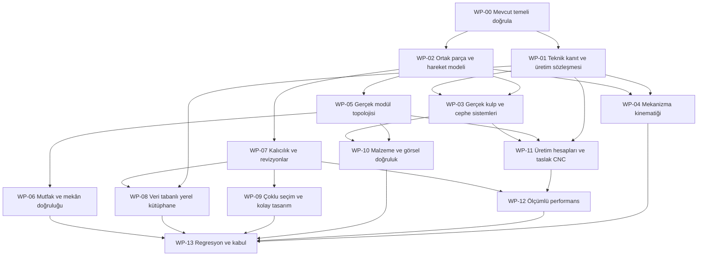

# V4.2 ve sonrası — ayrıntılı yürütme yol haritası

Tarih: **2026-11-05**. Durum: **PLAN — bu belgede sıralanan işler uygulanmış sayılmaz**.

Bu yol haritası V4.1 bağımsız denetimindeki açık işleri kalıcı, test edilebilir iş paketlerine dönüştürür. Yeni sürüm adları önerilen kilometre taşlarıdır; yayın, teslim tarihi veya production yetkisi anlamına gelmez. Kullanıcı yeni öncelik verirse sıra değişebilir; veri güvenliği ve doğrulanmamış üretim kuralları korunur.

## 1. Hedef ve mevcut gerçek durum

Hedef: mağaza personelinin kolay kullanabildiği, aynı parametrik tasarımdan tutarlı 2D/3D/BOM/fiyat üreten, teknik doğrulama kapsamını açıkça gösteren dolap/mutfak konfigüratörü.

V4.1 başlangıç kanıtı:

- Dal `codex/v41-independent-audit`; son gözlenen HEAD `27e3938`.
- V4.1 kodu ve raporları çalışma ağacında; bu yol haritası yazılırken commitlenmemiştir.
- 87 unit/regresyon ve 27 Chromium testi geçti; son kayıt-hatası görünümü ayrıca hedefli test edildi. Yeni oturumda yeniden doğrulanmalı.
- 92 şablon varsayılan hesaplamalar açısından tarandı; ürün ailesinin tüm fiziksel/geometrik ayrıntıları onaylanmadı.
- 50 modüllü tarayıcı sahnesinde 632 mesh, 1.158 draw call ölçüldü. CPU render çağrısı yaklaşık 3,6 ms; bu GPU süresi veya sürekli FPS değildir.
- **Tam kabul yok. Üretim/CNC onayı kapalı.**

Başvuru: [devir notu](NEXT_AGENT_HANDOFF.md), [kabul raporu](V41_ACCEPTANCE_REPORT.md), [hata kaydı](V41_BUG_REGISTER.md), [performans](V41_PERFORMANCE_RESULTS.md).

## 2. Değişmez çalışma sınırları

1. Yalnız Configurator deposunda değişiklik; ERP/Store depolarında değişiklik yok.
2. Ortak Supabase staging/production bağlantısı/yazması, gerçek müşteri verisi ve deployment yok.
3. Commitlenmemiş mevcut çalışmaları koru. Yeni dal/worktree kararı mevcut Git durumuna göre verilmeli; bu plan otomatik checkout/commit/merge emri değildir.
4. Üretici ürün numarası, teknik çizim, montaj ölçüsü, yük sınırı, CNC komutu veya fiziksel doğrulama sonucu uydurma.
5. Üretim engellerini kaldırarak, testi gevşeterek, bozuk seçeneği sessizce gizleyerek veya sahte UI ekleyerek işi tamamlanmış gösterme.
6. V2/V3 projeleri ve rotaları korunmalı. Veri değişiminde migration, round-trip ve rollback birlikte tasarlanmalı.
7. Yerel taslak katalog ile fiziksel olarak onaylanmış katalog ayrılmalı. Taslak sürümün yayınlanması üretime uygunluk anlamına gelmemeli.

## 3. Öncelik ve durum sözlüğü

| Değer | Anlam |
|---|---|
| P0 | Veri/hesaplama güvenilirliği, kalıcılık veya üretim güvenliği |
| P1 | Ana tasarım akışını veya ürün doğruluğunu etkileyen eksik |
| P2 | Ölçülmüş performans, kullanım kolaylığı ve görsel kalite iyileştirmesi |
| TODO | Henüz başlanmadı; öneri veya tasarım tamamlanmış özellik değildir |
| IN PROGRESS | Uygulama sürüyor; somut kalan iş yazılmalı |
| NEEDS EVIDENCE | Harici teknik/fiziksel kanıt eksik; bağımsız güvenli alt işler sürdürülebilir |
| READY FOR REVIEW | Kod, test ve kanıt hazır; inceleme sonucu bekleniyor |
| DONE | Bu WP'nin tüm kabul koşulları karşılandı; kapsam/test/commit kanıtı kaydedildi |

Bir WP'nin `DONE` olması bütün ürünün üretime hazır olduğu anlamına gelmez. Alt işler ayrı duruma sahip olabilir.

## 4. Bağımlılık ve önerilen sıra

Bu şema otomatik ajan delegasyonu istemez; işlerin teknik bağımlılıklarını gösterir. Kaynak/fabrika kanıtı beklenirken şema, migration, test fixture'ı ve güvenli yerel taslak akışları yapılabilir.

## 5. WP-00 — mevcut temeli sabitle ve yeniden doğrula

**P0 · TODO · Bağımlılık: yok.**

Yapılacaklar:

- Git diff ve untracked dosya envanterini kaydet; önceki denetimde hangi dosyaların değiştiğini tanı.
- V41 bug ID'lerini kaybetmeden mevcut karşılıklarını kaynakta bul. Önceden düzeltilmiş bir hatayı tekrar yeni özellik olarak üretme.
- Unit ve TypeScript temel koşusunu çalıştır. Render/state/persistence değişikliği öncesinde izole Chromium temelini de doğrula.
- Hatalı temel varsa WP kimliğiyle ayır: ortam/port/derleme sorunu mu, mevcut hata mı, yeni regresyon mu?
- Çalışan sunucuları ve port sahiplerini not et; `.next`/`.next-v41` karışmasını önle.
- Çalışma ağacının commit/snapshot düzenini mevcut kullanıcı talimatına göre koru; kullanıcı değişikliklerini toplu commit'e katma.

**Kabul:** güncel dal/HEAD/diff özeti, gerçek komut sonuçları, kanıt dizini ve ilk seçilen iş kaydedilmiş olmalı. Geçmişteki 87/27 sayılarını yeniden koşulmuş gibi yazma.

## 6. WP-01 — teknik kaynak ve üretim doğrulama sözleşmesi

**P0 · TODO / fiziksel kapsam NEEDS EVIDENCE · V41-R06.**

Dosyalar: `packages/core/src/v4-compatibility.ts`, `packages/catalog/src/v4-hardware-catalog.ts`, `v4-library-admin.ts`, `docs/SOURCE_REGISTER.md`, `docs/RESEARCH_MANUFACTURERS.md`.

Yapılacaklar:

- Kaynak kaydı için üretici, tam ürün/SKU, çizim/katalog sürümü, tarih, sayfa/bölüm, URL veya yerel belge, ölçü birimi ve geçerli varyantları tanımla.
- Doğrulamayı kaynak/CAD/BOM/delik/fiziksel numune kapsamlarına ayır; her onayın kanıtı, kapsamı ve geçerli tasarım/katalog sürümü olsun.
- Belgenin ne söylediği ile uygulamanın yaptığı çıkarımı ayrı kaydet. Kullanılacak teknik iddiaları güncel birincil üretici kaynaklarından doğrula.
- `sourceId` bulunmasını tek başına teknik onay kabul etme. Kullanıcı arayüzünde işaretlenen boolean fiziksel test kanıtı değildir.
- Parça/işlem bazlı kanıt kapsama matrisi tasarla. Güncel proje genelindeki `V41_FACTORY_RULES_UNVERIFIED` kaldırılmadan önce hangi kapsamın eksiksiz kapandığı kanıtlanmalı.
- Kaynak değişince hangi katalog/şablon/tasarım doğrulamasının geçersizleşeceğini tanımla.

**Test:** kaynaksız veri, süresi/sürümü uyuşmayan kaynak, eksik fiziksel kapsam, taslak katalog ve kullanıcı JSON'undan gelen sahte approval. Hepsi üretime kapalı kalmalı.

**Kabul:** kanıt ilişkisi şeması + örnek yerel kayıt + fail-closed testler. Fiziksel fabrika kanıtı yoksa bu alt kapsam `NEEDS EVIDENCE` kalır; production gate açılmaz.

## 7. WP-02 — tek parça/cephe/hareket sözleşmesi

**P1 · TODO · Bağımlılık: WP-00.**

Dosyalar: `packages/core/src/types.ts`, `schemas.ts`, `v4-profiles.ts`, `rules.ts`; `packages/geometry/src/types.ts`, `mesh-generator.ts`, `component-transform.ts`, `projection2d.ts`; `apps/configurator/src/components/componentMesh.ts`.

Yapılacaklar:

- Gövde dış ölçüsü, net kullanılabilir hacim, kesim ölçüsü ve cephe ölçüsünü açıkça ayır; aynı büyüklüğü farklı motorlarda farklı formüllerle hesaplamayı azalt.
- Mevcut birimler/eksenler: mm; X genişlik, Y yükseklik, Z derinlik. Modül Y dönüşü derece, component Euler rotasyonu radyan. Bunları tip ve testlerle görünür kıl.
- Gövdeye bağlı nesne ile hareketli cepheye bağlı nesneyi açık parent/transform ağacında modelle. Gola'nın sabit olması ile kapak kulpunun hareket etmesi ayrımı korunmalı.
- Parça kimliği, fiziksel rol, panel düzlemi/kalınlık ekseni, malzeme, kenar, delik referansları ve hareket dönüşü tek sözleşmede tanımlansın.
- UI-only render ayrıntısını üretim parçasından ayır; bir profil meshinin yanlışlıkla panel BOM'una girmesini önle.
- 2D'yi gerçek dönüştürülmüş köşe/poligonlardan üret; AABB çizimini kesin teknik kontur diye sunma. Açık kapakta viewbox kırpılmasını test et.
- Eski proje JSON'u için açık, sürümlü migration hazırla; stabil kimlikleri gereksiz değiştirme.

**Test:** 16/18/22 mm kalınlık, inset/overlay, sol/sağ/çift, 0/45/90° hareket, 0/90/180/270° modül dönüşü; 2D köşeler/3D köşeler/BOM kesimleri ve round-trip karşılaştırması.

**Kabul:** ilgili ölçü bir kez çözülür, tüketiciler aynı sonucu kullanır; V2 ve V3 render yolları eşdeğerdir; üretim ve görsel temsil ayrımı test edilir.

## 8. WP-03 — gerçek kulp ve cephe sistemlerini tamamlama

**P1 · TODO · Bağımlılık: WP-01 + WP-02 · V41-01, V41-R05/R06.**

Dosyalar: `handle-geometry.ts`, `mesh-generator.ts`, `v4-hardware-catalog.ts`, `v4-compatibility.ts`, `bom-generator.ts`, `drilling-engine.ts`, `useV3Adapter.ts`.

Yapılacaklar:

- Kategori, seçilen profil/ürün, montaj yönü/konumu ve açılma teknolojisini ayrı alanlar olarak kesinleştir. Bay seviyesinde varsayılan ve cephe başına override ihtiyacını çöz.
- Uzun kulpu küçük kapakta sadece görsel olarak kısaltıp SKU/deliklerini aynı bırakma; geçersiz kombinasyonu açık validasyonla yönet.
- Düğme/bar/dekoratif kulpta ölçülü ürün geometrisi; kenar profilinde gerçek kesit; gömme/J-pull/ahşap oymada gerçek cephe işlemesi ve kesit geometrisi oluştur.
- Gola'yı gövde kanalı/profil hattı olarak çöz; iki kapakta ortak profilin BOM'da iki kez sayılmasını ve çakışan profil çizilmesini denetle.
- Kulp montaj koordinatı doğrulandıysa geometri, delik, montaj çizimi, SKU/adet ve maliyet aynı çözümden türesin. Yoksa delik üretme; teknik doğrulama beklediğini göster.
- Cephe açılırken/çekmece çekilirken profil bağlantısını, sağ/sol mirroring'i ve iç çekmece istisnasını koru.

**Kabul:** on kategorinin sol/sağ/çift/çekmece matrisi, malzeme ve profil değişimi, kaldırma, undo/redo ve reload geçer. Geçersiz ölçü ve kaynaksız delik senaryosu da test edilir. Sertifikalı olmayan temsil etiketlenir.

## 9. WP-04 — fiziksel olarak tutarlı kapak kinematiği

**P1 · TODO / ürün verisi NEEDS EVIDENCE · Bağımlılık: WP-01 + WP-02 · V41-R01.**

Yapılacaklar:

- Önce bir ürün/mekanizma ailesini uçtan uca tamamla; bütün sistemler için ayrı ayrı sahte interpolasyon ekleme.
- Menteşeli: pivot ekseni, açılma yönü/açı sınırı, overlay ve açılım hacmi.
- Sürgülü: ray düzlemleri, kanat sayısı, bindirme, son konumlar, komşu kanat/kulp geçişi; dönme olmamalı.
- Kalkar: üst menteşe veya üretici bağlantı geometrisine uygun paralel/katlanır hareket, tavan ve komşu hacim kontrolü.
- Katlanır: ortak mafsala bağlı ikinci kanat; iki bağımsız döndürülmüş kutu yeterli değil.
- Pocket: açılma ve geri çekilme evreleri, cep boşluğu/servis payı ve aksesuar çarpışması.
- Tambur: lamel/bükülme/kanal davranışı; görünen panel yüksekliğini azaltmak fiziksel kinematik sayılmaz.
- Hareket evresine göre kapak, kulp, mekanizma ve engellerin çarpışma hacmini hesapla. Temsili sistem ayrı statüde kalmalı.

**Test:** 0/25/50/75/100% hareket; bağlı mafsal mesafesi korunumu; ray dışına çıkmama; bağlı kulp mesafesi; komşu modül/tezgâh/tavan/engel çarpışması; BOM'un açık/kapalı durumda değişmemesi.

**Kabul:** ürün bazlı kaynak ve mekanik invariant testleri + aynı kamera açık/kapalı tarayıcı görüntüsü. Sadece matris değişimi veya güzel animasyon geçerli kabul kanıtı değildir.

## 10. WP-05 — modül kataloğunu gerçek topolojiye dönüştürme

**P1 · TODO · Bağımlılık: WP-02 · V41-R02.**

Dosyalar: `packages/catalog/src/v4-module-taxonomy.ts`, `templates.ts`, `packages/geometry/src/mesh-generator.ts`, `packages/core/src/rules.ts`, `packages/manufacturing/src/bom-generator.ts`.

Yapılacaklar:

- 92 satırı kaynak şablon, gerçek işlev, geometri stratejisi, teknik sınır ve doğrulama kapsamına göre sınıflandır.
- Her şablonu varsayılan/minimum/maksimum/sınır dışı ölçülerde denetle. Pozitif mesh ölçüsü geçerli iç hacim veya gerçek modül işlevi anlamına gelmez.
- Köşe/diyagonal/eğimli tavan/merdiven altı gibi modüllere gerçek panel topolojisi ekle; gereken yerde dikdörtgen dışı kesim konturu ve kenar/delik koordinatı modeli kullan.
- Evye, fırın, mikrodalga ve buzdolabında cihaz açıklığı, arka boşluk, taşıyıcı kuşak, havalandırma ve servis gereksinimlerini ürün kaynağına bağla.
- Cam çerçeveli cepheyi tek cam kutu yerine çerçeve + dolgu olarak üret. Ayak/askı/tel sepet gibi donanımları yanlışlıkla ahşap raf BOM'una sokma.
- Tamamlayıcı parçalarda yön/kalınlık/yerleşim ve gerçek parça sayısını doğrula.
- Birbirinin aynısı şablonlarla sayıyı artırma; hatalı veya temsil düzeyindeki mevcut şablonu açık statüyle koru.

**Kabul:** aile başına en az bir tamamlanmış gerçek temsil ve ilgili kesim listesi; ardından tüm aileye yayılım. 92/92 satırda kapsam ve kanıt ayrı yazılır. Ürün işlevi, 2D/3D/BOM ve min/max round-trip aynı senaryoda geçer.

## 11. WP-06 — mutfak ve mekân mühendisliği

**P1 · TODO · Bağımlılık: WP-02 + WP-05 · V41-R02.**

Dosyalar: `packages/catalog/src/kitchen-layouts.ts`, `v4-smart-builder.ts`, `apps/configurator/src/v3/engine/kitchenSpatialEngine.ts`, `V3CadViewport2D.tsx`, `V3ThreeViewport.tsx`.

Yapılacaklar:

- Düz/L/U/paralel/ada/yarımada için gerçek duvar koordinatları ve dönüş konvansiyonunu tek modelden çöz.
- Örnek mimari engelleri gerçek rölöve olarak göstermeden, sample/proje verisi ayrımı yap; gerçek projede bilinmeyen duvar/tesisatı uydurma.
- Kapı/pencere/kolon/kiriş, tesisat, priz ve havalandırmayı konum/yükseklik/derinlik açısından doğrula.
- Köşe dolgu, duvar toleransı, cihaz servis ve montaj boşluğu, kapak açılımı, tezgâh ek yeri/evye kesimi ve baza sürekliliğini ayrı kontrol et.
- 3600 mm önerilerini sadece genişlik toplamına göre üretme; kapak genişliği, sehim, donanım, cihaz ve servis payını da çöz. Sığmayan öneriyi nedenleriyle reddet.
- Snap, duvar hizalama ve komşu modül yaklaşımını döndürülmüş footprint ile çalıştır; öneri uygulaması tek undo işlemi olsun.

**Kabul:** her yerleşim ailesinde ölçülü 2D/3D pozisyon eşitliği; en az bir cihaz/engel çakışması ve bir geçerli örnek; filler/tezgâh/BOM tutarlılığı. Çakışmalı örneğin güzel görünmesi kabul değildir.

## 12. WP-07 — sürümlü kalıcılık, revizyon ve atomik işlemler

**P0/P1 · TODO · Bağımlılık: WP-00; WP-02 şema kararıyla uyumlu.**

Dosyalar: `packages/core/src/schemas.ts`, `v4-profiles.ts`, `apps/configurator/src/store/useConfiguratorStore.ts`, `useV3Adapter.ts`, `V3ProjectModal.tsx`, `ProjectSaveLoadModal.tsx`.

Yapılacaklar:

- Proje dosyası format sürümü ile tasarım revizyonu ve katalog sürümünü ayır. Desteklenmeyen ileri sürümü sessiz alan silerek yükleme.
- V2/V3/V4 örneklerini migration fixture'ı olarak sakla; alanların, kimliklerin ve kullanıcı override'larının korunmasını denetle.
- Yerel kayıt için bozuk liste, kota, yarım yazma, import boyut sınırı, çakışan kimlik ve ileri format senaryolarını ele al; başarısız yüklemede mevcut tasarım değişmesin.
- Revizyon snapshot'ı, kaydedilmiş son durum ve geçici edit/history ayrımını tanımla; onaylı snapshot'ı düzenlenebilir modelle aynı obje yapma.
- Drag ve slider değişikliklerini tek kullanıcı hareketi/tek undo olarak grupla; her piksel için bağımsız üretim revizyonu üretme.
- Undo/redo sonrası seçim indeksini, BOM/fiyatı, kayıt göstergesini ve approval statüsünü birlikte doğrula.
- Otomatik kayıt istenecekse gerçek yazma, debounce, hata ve geri yükleme akışını uygula; yazma olmadan başarı etiketi ekleme.

**Kabul:** kaydet → yenile → yükle → düzenle → revizyon oluştur → undo/redo → tekrar kaydet zinciri eski/yeni fixture'larda geçer. Kalıcı kayıt ve UI göstergesi aynı gerçek durumu ifade eder.

## 13. WP-08 — veri tabanlı yerel kütüphane ve gerçek sürümleme

**P1 · TODO · Bağımlılık: WP-01 + WP-07 · V41-R03.**

Dosyalar: `packages/catalog/src/v4-library-admin.ts`, `v4-module-taxonomy.ts`, `v4-hardware-catalog.ts`, `apps/configurator/src/v3/components/V3UnifiedWorkspace.tsx`.

Yapılacaklar:

- Executable `createInstance` fonksiyonu yerine doğrulanabilir deklaratif şablon tanımı ve güvenli resolver tasarla. Kullanıcı formülünü `eval`/`Function` ile çalıştırma.
- Parametrik ölçüler, cephe/kulp/donanım ilişkileri, malzemeler, teknik kaynaklar ve uyumluluk kuralları için sürümlü şemalar oluştur.
- Önce izole yerel repository/storage adaptörü kur; bu görev ortak Supabase ortamını kullanma yetkisi vermez.
- Yeni/kopyala/düzenle/önizle/incelemeye gönder akışlarını gerçekten modele ve taslak kataloğa bağla. Salt metadata formunu tamamlanmış runtime şablon editörü diye raporlama.
- Kaynak kod değiştirmeden eklenen yerel ürün/modülün gerçek geometri, uyumluluk, BOM ve fiyatta çözülebildiğini göster.
- Release snapshot'ına yalnız ad/sayı değil, resolver için gereken gerçek tanımlar/kaynaklar/sürüm ilişkileri girsin. Gerçek içerik hash'i, immutable snapshot ve duplicate sürüm kontrolü olsun.
- Rollback geçmiş içeriği değiştirmeden önceki release'i aktif hale getirmeli; projeler pinlenmiş kataloglarıyla açılabilmeli.
- `DRAFT/REVIEW/VERIFIED/PUBLISHED/DEPRECATED` geçişlerini kanıt kapsamıyla denetle. Kullanıcı checkbox'ı üretim onayını kendi kendine açmamalı.
- Harici çok kullanıcılı backend kapsamı açılırsa kimlik/rol, yetki ve audit log ayrı güvenlik işi olarak tasarlanmalı; yerel demo buna eşdeğer gösterilmemeli.

**Test:** şema hatası, expression sınırı, taslak ürün çözümleme, source eksikliği, duplicate ID/sürüm, snapshot mutation, eşzamanlı publish, reload, rollback ve eski proje açılışı.

**Kabul:** UI'dan gerçek yerel şablon/donanım ekle → örnek modül oluştur → 2D/3D/BOM/fiyat → kaydet/yükle → sürüm değiştir → geri dön akışı geçer; üretim onayı hâlâ doğrulama kapsamına bağlıdır.

## 14. WP-09 — kolay tasarım, çoklu seçim ve toplu düzenleme

**P1 · TODO · Bağımlılık: WP-07; yerleşim için WP-06 · V41-R04.**

Yapılacaklar:

- `selectedModuleIds` ve aktif odak ayrımını kur; indeks yerine stabil kimlikleri esas al. Çoklu seçim, sürükleme kutusu, shift/toggle ve tablet dokunmasını tasarla.
- Toplu malzeme/kulp/donanım/ölçü düzenlemesinde “karışık değer”, desteklenmeyen seçim ve kısmi başarısızlık davranışını açıkça tanımla.
- Tek toplu değişikliği atomik commit ve tek undo olarak işle. Her seçilen modülün BOM/fiyatı doğru yeniden hesaplanmalı.
- Kopyalama, silme, hizalama, snap ve komşuya yerleştirmede kimlik/çarpışma/duvar sınırlarını koru.
- Raf/bölme/çekmece ekleme ve iç düzen şablonlarını görünür sonuçla bağla; seçim kapsamı belli olsun.
- Teknik ayarları günlük satış akışından ayır; erişilebilir adlar, klavye odak sırası, dokunma hedefleri ve hata açıklamaları ekle.

**Kabul:** en az üç farklı modülde toplu değişiklik, karışık değer, uyumsuz tek modül, iptal, undo/redo ve reload gerçek Chromium'da doğrulanır. Tablet kaydırma ile sürükleme birbirini bozmaz.

## 15. WP-10 — fiziksel ölçekte malzeme ve görsel doğruluk

**P2 · TODO · Bağımlılık: WP-02 + ilgili gerçek geometri · V41-R05.**

Dosyalar: `apps/configurator/src/v3/materials/pbrMaterialSystem.ts`, `componentMesh.ts`, `packages/core/src/defaults.ts`.

Yapılacaklar:

- Malzeme metadata'sında fiziksel doku boyutu, damar yönü, yüzey/kenar ayrımı ve kalınlık uyumluluğu belirt.
- Panel büyüdüğünde damar deseni aynı sayıda devleşmesin; UV ölçeğini mm üzerinden çöz. Paylaşılan material/texture değişiminin komşu parçaları bozmasını önle.
- Meşe/ceviz/kaplama/melamin/lake/cam/füme/metal/ayna/tezgâh için ayrı fiziksel ve görsel beklenti yaz; bronze mirror sıradan koyu cam gibi onaylanmamalı.
- Saydam yüzeylerde derinlik/sıralama/arka yüz/çerçeve davranışını açık ve kapalı kapakta denetle.
- Gerçek varlık ihtiyacı ve bütçeyi ölçtükten sonra KTX2/decoder/fallback hattını değerlendir; yalnız büyük doku ekleyerek kaliteyi zorlamama.
- Cache anahtarına görsel varyant/UV kapsamını doğru kat; sahne kaldırma ve doku yaşam döngüsünü doğrula.

**Kabul:** aynı kamera/ışıkla seçilen malzemelerin kaydı, BOM/fiyatı ve görünümü eşleşir; fiziksel damar ölçeği iki farklı panel ölçüsünde karşılaştırılır; cam/ayna için özel görsel inceleme ve performans kaydı bulunur.

## 16. WP-11 — üretim hesaplarının teknik kapsamını tamamlama

**P0 · TODO / fabrika kapsamı NEEDS EVIDENCE · Bağımlılık: WP-01 + WP-02 + ilgili WP-03/05.**

Dosyalar: `packages/manufacturing/src/bom-generator.ts`, `drilling-engine.ts`, `sheet-nesting.ts`, `technical-outputs.ts`, `selco-adapter.ts`; `packages/pricing/src/pricing-engine.ts`.

Yapılacaklar:

- Panelin kalınlık eksenini tipli rolden çöz; en küçük eksen yaklaşımının dar/özel parçalarda yeterliliğini ayrıca doğrula.
- Her deliği parça yüzü, yerel eksen, yön, çap, derinlik, donanım kaynağı ve doğrulama kapsamıyla ilişkilendir. Koordinat sınırı/kenar mesafesi/delik çakışmasını denetle.
- Menteşe/ray/kulp ve bağlantı adetleri gerçek yapısal seçime dayanmalı; iç donanımı raf ve yanlış bağlantı elemanı olarak sayma.
- BOM'un açık/kapalı animasyondan bağımsız olduğunu; tasarım/katalog/material girdisi değişince güncellendiğini doğrula.
- Nesting'de malzeme+kalınlık+damar, trim, kerf, miktar, döndürme, plaka sınırı ve sığmayan parça raporunu genişlet. Kesim konturu dikdörtgen dışıysa algoritmanın kapsamını açıkça göster.
- Kesim sırası ve makine postprocessor'ını yerleşim görselinden ayır. Selco kerf/kıskaç/minimum parça/controller varsayımları fiziksel kaynakla doğrulanmadan taslak kalmalı.
- Fiyat parametrelerine tarih/kaynak/para birimi/sürüm ekle; kur, vergi, fire, margin/markup anlamları ve kalınlığa bağlı maliyeti ayrı test et. Güncel oranları tahmin ederek güncelleme.

**Kabul:** bilinen elle hesaplanabilir referans tasarımlar; parça/delik/SKU/fiyat karşılaştırması; bounds/overlap/grain testleri; eksik kanıtta üretim engeli. Harici CNC/ERP aktarımı bu yerel yol haritasının otomatik son adımı değildir.

## 17. WP-12 — ölçümlü performans ve gerçek worker

**P2 · TODO · Bağımlılık: WP-07 + kararlı hesap/geometri sözleşmeleri · V41-R07.**

Yapılacaklar:

- 1/20/50 modülde ilk yükleme, seçim, kulp/kapak/malzeme/ölçü değişimi, görünüş geçişi, BOM ve nesting için tekrarlı p50/p95 ölçümleri oluştur.
- Olay handler süresi ile kullanıcıya görünür tamamlanma, CPU submission ile GPU zamanı, rAF cadence ile gerçek render FPS ayrımını koru.
- Aynı anda görünür 50 modüllü sahnede draw call, mesh/triangle, geometry/texture, heap trendi ve React render sayısını kaydet; ortam/browser/viewport/build bilgisi ekle.
- State'de tüm modülleri kopyalayan mutation ve tam scene rebuild noktalarını profille. Önce yalnız değişen modül/cepheyi güncellemeyi tasarla.
- Tekrarlanan gövde/aksesuar ve kenar çizgilerinde instancing/batching değerlendir; picking/selection/metadata doğruluğunu koru.
- Gerçek `Worker` içinde nesting/uygun ağır hesabı çalıştır. Mesaj sözleşmesi `projectId + revision + jobId` içersin; yeni proje açılınca eski sonuç geri dönmemeli.
- Sadece sürüm numarasının monotonluğuna güvenme: undo, import, aynı revizyonlu ardışık istek ve proje değişimi senaryolarını test et.
- Cache'ler bounded olsun; girdi tamlığı ve dışarıdan mutation riski denetlensin. Kaynak disposal ve iptal/error mesajlarını ölç.

**Önerilen deney hedefleri — kabul edilmiş SLA değildir:** 50 modülde draw call'u en az %50 azaltmayı ve yaygın görünür edit p95'ini 100 ms altında tutmayı değerlendir. Donanım/build/kalite düzeyi belirlenmeden bunları sonuç veya garanti sayma. Geometri/CNC doğruluğu performans için değiştirilmemeli.

**Kabul:** önce/sonra aynı senaryo ve ortam; doğruluk testleri aynı anda geçer; gerçek worker'da main-thread uzun görev azalması kanıtlanır; uzun kullanımda kaynak sayısı sınırsız artmaz. Ölçülmeyen FPS/heap için başarı iddiası yok.

## 18. WP-13 — görsel regresyon ve son kabul

**P1/P2 · TODO · Bağımlılık: kabul edilecek WP kapsamlarının tamamlanması · V41-R08.**

Yapılacaklar:

- Testleri hesaplama/kalıcılık/gerçek tarayıcı/görsel/üretim doğrulaması katmanlarında tut; biri diğerinin yerine geçmesin.
- On kulp kategorisini ve tüm kapak sistemlerini değişen açılarda/ölçülerde sınayan matrisleri sürdür.
- 92 katalog satırının varsayılan/min/max/uyumsuz kombinasyon kayıtlarını güncelle; yeni şablon geldiğinde envanter testi bunu fark etsin.
- Kaydet/yükle/revizyon/undo/redo/import/migration ve izole katalog sürümü akışlarını gerçek kullanıcı işlemleriyle doğrula.
- Sabit kamera/ışık/viewport, kararlı veri/texture seed ve browser sürümüyle görsel fixture kur. Onaylı baseline ile aday çıktı dizinini ayır; bilinen hatalı görüntüyü otomatik kabul etme.
- Referanslar: standart çift kapak açık/kapalı; bar/gömme/kulpsuz; çekmece açık/kapalı; sürgü; ahşap/lake/füme; gerçek köşe/L mutfak; Showroom. Aday eski görüntüler gerçek topoloji doğrulanmadan onaylanmamalı.
- Küçük tablet/landscape dokunma, klavye ve masaüstü etkileşimini denetle. Viewport emülasyonu ile gerçek cihaz performansını ayır.
- Her kabul satırına test adı, son koşu, ortam, sonuç, kanıt ve kalan sınır ekle. Yeni sürüm raporlarını yeni isimle oluştur; V41 tarihli raporları geçmiş kayıt olarak koru.

**Kabul:** kritik akışlar ve ilgili hesaplar geçer; görsel farklar incelenir; tüm açık P0/P1 kayıtlarının durumu açıkça yazılır; fiziksel doğrulama yoksa ürünün yazılım kabulü ile üretim kabulü ayrı kalır.

## 19. Önerilen kilometre taşları

| Aşama | Kapsam | Çıkış koşulu |
|---|---|---|
| V4.2 — güvenilir veri ve geometri temeli | WP-00/01/02/07; WP-03 için bir referans cephe | Kayıt/migration/ölçü sözleşmesi ve üretim kanıt modeli; gerçek uçtan uca referans |
| V4.3 — gerçek ürün davranışı | WP-03/04/05/06 | Seçilen ailelerde gerçek topoloji/kinematik/mekân; diğerlerinin kapsamı açık |
| V4.4 — yönetilebilir kütüphane ve mağaza akışı | WP-08/09 | Yerel veriyle gerçek authoring/rollback; çoklu seçim/toplu edit ve kalıcılık |
| V4.5 — görsel kalite ve büyük proje verimliliği | WP-10/12 ve WP-13 görsel altyapısı | Ölçülü malzeme, gerçek worker, önce/sonra performans ve incelenmiş baselinelar |
| Üretim kabulü — ayrı teknik kapı | WP-11 + WP-01 fiziksel kapsam + WP-13 | Üretici/fabrika kanıtı, fiziki numune ve postprocessor doğrulaması; ayrıca kullanıcı kapsamı |

Bu sürüm numaraları uygulanabilir iş gruplarıdır; takvim taahhüdü değildir. Bir sonraki ajan tüm aşamaları tamamlanmış olarak işaretleyemez.

## 20. Canlı ilerleme kaydı

Her çalışma sonunda bu tablo güncellenmeli. Detaylı alt görev gerekiyorsa WP kimliğinin altına `WP-08.1` gibi sabit alt kimlik ekle.

| WP | Başlangıç durumu | Son kanıt / commit | Kalan sonraki adım |
|---|---|---|---|
| WP-00 | DONE (2026-11-05) | `git status`, `npm test` (107/107), `npm run lint` (0 hata), `test:e2e:v41` (27/27) | Yeni oturum başında tekrar temel kontrol |
| WP-01 | IN PROGRESS / NEEDS PHYSICAL EVIDENCE | `v4-source-registry.ts`, `evidenceMatrix`, `CHK_15_*` fail-closed kapıları ve kaynak revizyon invalidasyonu eklendi (`tests/v42-source-geometry-persistence.test.ts`) | Fabrika fiziksel numune ve üretici CAD/montaj sertifikasyonu (harici kanıt) |
| WP-02 | DONE (2026-11-05) | `fourSpace.doorLeaves` tek kaynak sözleşmesi, 92/92 şablonda `0` ölçü uyumsuzluğu, 2D açılır kapak/çekmece dinamik `viewBox` genişletmesi, `thicknessAxis` ve `isManufacturablePanel` ayrımı (`tests/v42-source-geometry-persistence.test.ts`) | Fiziksel numune tolerans kalibrasyonu |
| WP-03 | PARTIALLY DONE / NEEDS EVIDENCE | Bölme bazlı `setBayHandleCategory`, çekmece kulp taşmalarının engellenmesi, üst/boy dolaplarda kendinden kulpların (`j_pull`, `gola_profile`, `edge_profile`) ergonomik erişim kotuna (üst dolap alt kenarı / boy dolap bel-göğüs hizası) taşınması ve `gola_profile`+`inset`, `recessed_grip` min kalınlık, `long_profile_handle` boy sınırı kuralları eklendi | Üretici onaylı gerçek kulp delik/cep freze CAD koordinatları |
| WP-04 | PARTIALLY DONE / NEEDS EVIDENCE | `lift_parallel` (`AVENTOS HL` 4-çubuk paralelkenar), `lift_bi_fold` (`AVENTOS HF` 2 kanat katlanır), `folding_side` (`WingLine L`) ve `pocket_retractable` (`REVEGO` 2 aşamalı 90° pivot + lineer cep sürüşü) kinematik eğrileri ve BOM'a sızmayan (`isManufacturablePanel: false`) mekanizma kolu/ray bileşenleri eklendi (`packages/geometry/src/mesh-generator.ts`) | Üretici CAD eğrisi ve fiziksel numune doğrulaması |
| WP-05 | PARTIALLY DONE / NEEDS EVIDENCE | 92/92 V4 şablonu, mutfak mekân şablonları ve aktif modül panelleri için mimari 3B izometrik SVG görsel önizlemeler (`V3IsometricModuleIcon.tsx`: evye, fırın/mikrodalga, ocak, davlumbaz, buzdolabı, REVEGO pocket, cam vitrin, sürgü, kalkar kapak, L-köşe, eğimli tavan, merdiven altı, tamamlayıcı profiller) eklendi; `special_fitting` ve donanım tipi tamamlayıcı modüllerin ahşap `cutList`/nesting'e sızması engellendi; kör köşe, L-köşe ve ankastre fırın çok parçalı karkas bileşenleri eklendi | Fiziksel köşe/eğimli şablon fabrika doğrulaması |
| WP-06 | DONE (2026-11-05) | Oda & Duvar ölçüsü (`setRoomDimensions`), iç yüz (`y = z - thickness`) referanslı 90°/270° duvar köşe hizalaması, duvar seçip fareyle sürükleme ve `X/Z/Boy/Açı°` düzenleme (`updateWallSegment`), sürekli çoklu çizgi (polyline chain) duvar çizimi + CAD akıllı yakalama (uç nokta, orta nokta, iç/dış köşe, altlık köşesi, zincir başlangıcı ve 45°/90° açı yakalama), 2D planda Duvar/Engel/Modül seçip silme (`Del`/`Backspace` + toolbar) ve `Ctrl+Z`/`Ctrl+Y` geri/ileri alma, engelin hedef duvar seçimi veya planda tıklayarak/sürükleyerek `(X, Z)` konumlandırılması (`updateSpaceObstacle`), dışarıdan DWG/DXF/PDF/Görsel kat planı yükleme (`floorplan-parser.ts`) ve CAD çizgilerinden duvar üretimi (`importWallsFromUnderlay`), 3D AABB engel ve kapak açılım süpürme çakışması | DWG ikili (binary) format için sunucu/WASM dönüştürücü desteği |
| WP-07 | DONE (2026-11-05) | `schemaVersion: 4` zarfı, ileri şema (`>4`) reddi, V3->V4 migration, `beginHistoryTransaction`/`commitHistoryTransaction` atomik undo, global `Ctrl+Z`/`Ctrl+Y` klavye kısayolları ve `createRevisionSnapshot`/`diffRevisions`/`restoreRevisionSnapshot` eklendi | Çoklu sekme/oturum çakışma yönetimi |
| WP-08 | DONE (Yerel Kapsam, 2026-11-05) | `createDraftTemplateEntry` (parametrik `W/H/D` ve `defaultDoorSystemId` destekli — WP-08.1), `rollbackToRelease`, `saveToLocalStorage`, `loadFromLocalStorage`, `invalidateEntriesForSourceRevision` ve V4 Kütüphane Yöneticisi içinde canlı görsel önizlemeli yerel taslak oluşturma + release geri alma arayüzü (`v4-library-authoring-bar`) eklendi | Çok kullanıcılı merkezi veritabanı senkronizasyonu |
| WP-09 | DONE (2026-11-05) | Çoklu modül seçimi (`selectedModuleIds`, `toggleModuleSelection`, `selectAllModules`, `clearModuleSelection`, Shift+Click), 2D planda obje seçip silme (`Del`/`Backspace`) ve tek adımlı atomik undo destekli toplu taşıma/malzeme/silme (`batchMoveSelectedModules`, `batchSetSelectedModulesMaterial`, `batchRemoveSelectedModules`) eklendi | Sahne içi 3D marquee (kutu) seçimi |
| WP-10 | PARTIALLY DONE (2026-11-05) | `computePhysicalUvScale` ile milimetre tabanlı gerçek ölçekli UV tekrar ve lif yönü (`lengthwise`/`crosswise`) rotasyon hesabı eklendi (`pbrMaterialSystem.ts`) | Kalibre edilmiş fiziksel PBR stüdyo numune karşılaştırması |
| WP-11 | IN PROGRESS / NEEDS EVIDENCE | `isManufacturablePanel` ve `thicknessAxis` ile BOM/kesim doğruluğu sağlandı; `UNVERIFIED` üretim kapısı korundu | Kaynaklı parça/delik/postprocessor fiziksel fabrika doğrulaması |
| WP-12 | DONE (Yazılım Kapsamı, 2026-11-05) | `generateModuleGeometry` içine bounded modül geometri önbelleği (`moduleGeometryCache`) eklendi; `manufacturing-worker-client.ts` içine gerçek tarayıcı `Worker` (`Blob` URL worker thread) izolasyonu, `projectId + revisionId + sequenceId` mesaj zarfı, eski worker'ı anında sonlandırma (`worker.terminate()`) ve Node/Vitest fallback desteği eklendi | Farklı fiziksel cihazlarda GPU/FPS telemetri karşılaştırması |
| WP-13 | IN PROGRESS | 18 test dosyasında 107/107 unit/regresyon ve 27/27 Chromium E2E geçti | Onaylı görsel referans baseline ayrımı |

## 21. Her iş için tamamlanma kontrolü

- Somut hata/eksik ve tekrar üretme adımı yazıldı mı?
- Kaynak kod değişti mi; yalnız UI etiketi/rapor mu değişti?
- State, geometri, 2D, BOM/fiyat ve kalıcılık etkileri incelendi mi?
- İlgili gerçek browser işlemi ve hesap/regresyon testi var mı?
- Eski tasarım migration'ı ve undo/redo korunuyor mu?
- Yanlış/eksik teknik veride sistem fail-closed mı?
- Görüntü varsa inceleyen ve kabul kapsamı açık mı?
- Ölçüm varsa ortam, yöntem ve sınırlama kaydedildi mi?
- Devir notu, ilerleme tablosu ve kalan iş güncellendi mi?
- İlgili kod/kanıt gerçekten mevcut mu; DONE etiketi varsayıma mı dayanıyor?

Bu sorular karşılanmıyorsa iş kısmi statüde kalır. Planın amacı yeni ajanın nereden devam edeceğini bilmesi ve tamamlanmamış bir özelliğin zamanla yanlışlıkla “bitmiş” kabul edilmesini önlemektir.

