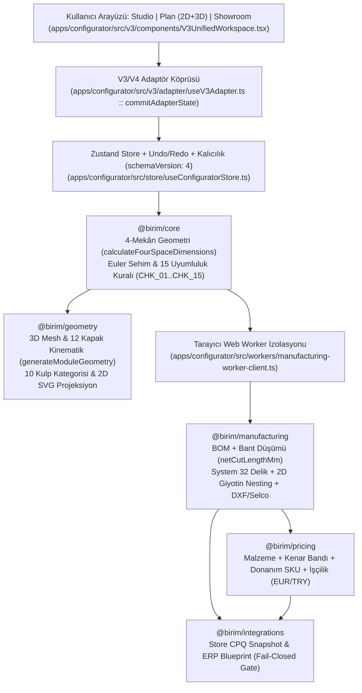

# Birim Configurator — Sistem Mimarisi ve Veri Akışı (L3 Storage)

> **Güvenilirlik Durumu:** `[VERIFIED]` (Kod tabanı `9169ec4` ile doğrulandı). Fiziksel fabrika CNC kesim kuralları `[UNVERIFIED]` olarak fail-closed tutulmaktadır.

## 1. Uçtan Uca Deterministik Veri Akışı

---

## 2. Dört Mekân (4-Space) Parametrik Geometri Sözleşmesi (`@birim/core`)

`packages/core/src/v4-profiles.ts` içindeki `calculateFourSpaceDimensions(module)` fonksiyonu; 3D sahne, 2D teknik çizim ve BOM kesim listesinin **aynı sayıları** kullanmasını sağlayan tek doğruluk kaynağıdır (`[VERIFIED]`):

1. **Dış Karkas Zarfı (`externalCarcass`):**
   - $W \times H \times D$ dış anma ölçüleri ve kapak dahil toplam derinlik ($D + T_{\text{door}}$).
2. **Net Panel Kesim Uzayı (`netPanelCut`):**
   - Gardırop modüllerinde yan paneller zemine kadar iner ($H_{\text{side}} = H$); mutfak alt dolaplarında baza üstünden başlar ($H_{\text{side}} = H - H_{\text{plinth}}$).
   - Alt ve üst tabla genişliği: $W_{\text{horiz}} = W - 2T$.
   - Kanallı arkalık (`grooved`): $W_{\text{back}} = (W - 2T) + 16\text{ mm}$, $H_{\text{back}} = H_{\text{inner}} + 16\text{ mm}$.
3. **Kullanılabilir İç Hacim ve Kapalı Ölçü Zinciri (`usableInternal`):**
   - `calculateBayWidths(module)` fonksiyonu $N$ bölmeli bir gövdede her zaman şu değişmezi sağlar:
     $$\sum_{i=0}^{N-1} W_{\text{bay},i} + (N + 1) \cdot T \equiv W$$
4. **Kapak Kanat, Ağırlık ve Güç Faktörü Uzayı (`doorLeaves`):**
   - Her bölme için kanat sayısı ($W_{\text{span}} > 600\text{ mm}$ ise otomatik çift kanat), kanat genişliği, alt çekmece veya ankastre cihaz boşluğuna göre otomatik kırpılmış kanat yüksekliği, kanat ağırlığı ($\text{kg}$), Blum AVENTOS güç faktörü ($\text{LF} = H_{\text{mm}} \times F_{\text{kg}}$) ve önerilen menteşe adedi (`2..5`) hesaplanır.

---

## 3. Kapak ve Kulp Kinematik Motoru (`@birim/geometry`)

- **10 Kulp Kategorisi (`packages/geometry/src/handle-geometry.ts`)** — `[VERIFIED]`:
  - Kategoriler: `knob`, `bar_handle`, `long_profile_handle`, `edge_profile`, `recessed_grip`, `gola_profile`, `j_pull`, `milled_wood_grip`, `decorative_bespoke`, `handleless_plain`.
  - Kulplar kapağın menteşe kenarının tam karşısındaki **açılma kenarına** ($45\text{ mm}$ içeride) ve ergonomik erişim yüksekliğine (mutfak üst dolapta alt kenara, boy dolapta bel/göğüs hizasına, alt dolapta üst kenara) bağlanır.
  - Kapak açıldığında kulp, kapağın `pivot` ve `rotation` matrisini miras alır (`resolveComponentTransform`); `gola_profile` ise karkasa sabit kalır.
- **12 Kapak Hareket Sistemi (`packages/geometry/src/mesh-generator.ts`)** — `[VERIFIED]` (Fiziksel fabrika kinematik kalibrasyonu `[UNVERIFIED]`):
  - **Menteşeli (`hinged_single`, `hinged_double`, `hinged_inset`, `hinged_overlay_variant`):** Sol veya sağ dış menteşe mafsalı (`pivot.z = front.position.z + T_door`) etrafında $\pm Y$ rotasyonu.
  - **Sürgülü (`sliding_top_hung`, `sliding_bottom_rolling`):** Ön ve arka ray düzlemlerinde ($\Delta Z = 25\text{ mm}$) doğrusal $X$ ötelemesi.
  - **Kalkar (`lift_up_stay`, `lift_parallel`, `lift_bi_fold`):** Üst kenar $-X$ rotasyonu, AVENTOS HL 4-çubuk paralelkenar yörüngesi ve AVENTOS HF çift kanat katlanır kalkar kinematiği.
  - **Katlanır (`folding_side`) ve Pocket (`pocket_retractable`):** WingLine L kuple kanat dönüşü ve REVEGO 2 aşamalı ($0\text{–}35\%$ $90^\circ$ pivot + $35\text{–}100\%$ cep içine $-Z$ sürüşü) hareketi.

---

## 4. Fabrika Üretim, BOM, CNC ve Nesting Motoru (`@birim/manufacturing`)

1. **Bitmiş Ölçü vs. Testere Net Kesim Ölçüsü (`packages/manufacturing/src/bom-generator.ts`)** — `[VERIFIED]`:
   - Her ahşap panel için hem bitmiş montaj ölçüsü (`lengthMm`, `widthMm`) hem de 4 kenar bandı kalınlığı düşülmüş ebatlama testeresi net kesim ölçüsü (`netCutLengthMm`, `netCutWidthMm`) hesaplanır:
     $$L_{\text{net}} = L_{\text{nominal}} - (e_{\text{top}} + e_{\text{bottom}}), \quad W_{\text{net}} = W_{\text{nominal}} - (e_{\text{left}} + e_{\text{right}})$$
   - `isManufacturablePanel: false` olan donanım/mekanizma bileşenleri ahşap kesim listesine (`cutList`) ve plaka optimizasyonuna sızmaz.
2. **ISO 7170 Euler-Bernoulli Raf Sehim Analizi (`packages/core/src/rules.ts`)** — `[VERIFIED]`:
   - $$\delta_{\max} = k_{\text{creep}} \cdot \frac{5 \cdot W \cdot L^3}{384 \cdot E \cdot I}, \quad I = \frac{D \cdot T^3}{12}$$
   - Hesaplanan sehim $\delta_{\max} \le L/300$ sınırını aşarsa `productionGate` uyarı verir ve `autoFixModuleIssues` otomatik düzeltme sunar.
3. **Çakışmasız System 32 & 35mm Menteşe CNC Delik Motoru (`packages/manufacturing/src/drilling-engine.ts`)** — `[VERIFIED]` (Fiziksel tezgâh testi `[UNVERIFIED]`):
   - Yan panellerde minifix/kavela delikleri, menteşe taban plakası delikleri ($x = 37\text{ mm}$ veya $57\text{ mm}$, $\Delta Y = 32\text{ mm}$) ve bunlarla çakışmayan ($\Delta Y \ge 12\text{ mm}$) System 32 raf pimi delikleri üretilir.
   - Doğrulanmış üretici şablonu olmadığı için kulp delikleri CNC delik listesine bilerek eklenmez.
4. **2D Giyotin Kesim Optimizasyonu & Stok Fire (`packages/manufacturing/src/sheet-nesting.ts`)** — `[VERIFIED]`:
   - Parçalar `materialId::thicknessMm` anahtarıyla ayrıştırılır, $4.4\text{ mm}$ testere kerf ve $15\text{ mm}$ kenar tıraşlama payıyla $2800 \times 2070\text{ mm}$ plakalara yerleştirilir; $\ge 300 \times 300\text{ mm}$ tekrar kullanılabilir stok fireler (`usableRemnants`) raporlanır.
5. **Katmanlı AutoCAD DXF (`packages/manufacturing/src/technical-outputs.ts`)** — `[VERIFIED]`:
   - `$INSUNITS = 4` (mm) başlığıyla `PANEL_CONTOUR`, `NET_CUT_CONTOUR`, `BACK_GROOVE_8MM`, `BORE_35MM`, `CAM_15MM`, `DRILL_8MM`, `DRILL_5MM` katmanlarında DXF üretilir.
